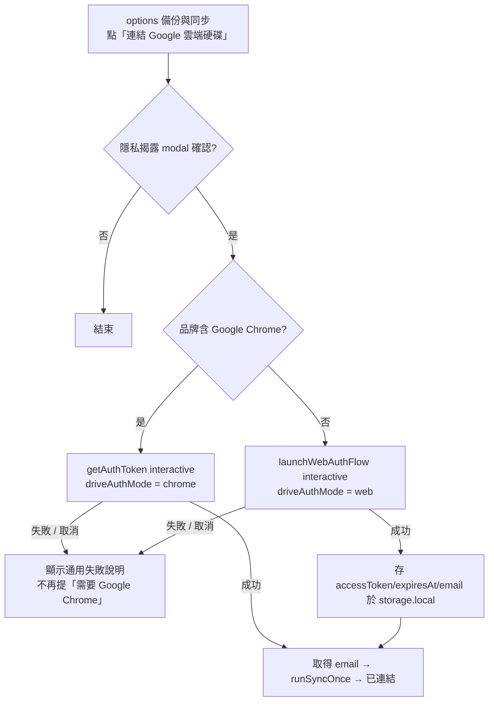

# ISSUE-257 — Dia 瀏覽器相容 + Dia ↔ Chrome 跨瀏覽器設定同步 PRD

| Attribute | Details |
| :--- | :--- |
| **Version** | v1.0 |
| **Status** | Review（§9 七項決策已由需求方定案；僅 P0 需在正式 Dia profile 驗證） |
| **Author** | Claude（依使用者 2026-10-28 需求起草） |
| **Reviewers** | Tai |
| **Created** | 2026-10-28 |
| **Last Updated** | 2026-10-28 |
| **Issue** | [#257](https://github.com/Tai-ch0802/arc-like-chrome-extension/issues/257) |
| **SDD 層級** | **T2**：改 `chrome.storage` schema（設定搬遷、閱讀清單側車）、`manifest.json` 新增 `email` scope、新增 Drive 檔案與跨 context 同步協定、OAuth 流程變更、涉及資料遺失風險（同步引擎） |
| **交付方式** | 單一 PR（需求方決定） |
| **前置研究** | 同目錄 `SPIKE.md`（Dia 1.54.2 實測 API 矩陣）、`dia-api-probe.js` |

---

## 1. Introduction

### 1.1 Problem Statement

使用者同時使用家中的 Google Chrome 與工作上的 Dia 瀏覽器（The Browser Company / Atlassian；Arc 於 2026-12-22 停服後的官方接棒者）。商店版擴充功能安裝到 Dia 後「點開沒有任何反應」，按「連結 Google 雲端硬碟」會被 Google 以 **`錯誤 400：invalid_request — Custom URI scheme is not supported on Chrome apps（flowName=GeneralOAuthFlow）`** 擋下。經 `SPIKE.md` 實測（Dia 1.54.2 = Chromium 156），斷點共五個：

| # | 斷點 | 根因 | 證據等級 |
|---|---|---|---|
| **P0** | **點擴充功能圖示沒有反應** | 待確認。Side Panel API 在 Dia 存在、`openPanelOnActionClick` 已設為 true、程式呼叫 `sidePanel.open()` 成功並產生面板 target；但隔離 profile 被登入牆擋住無法目視，也無法模擬工具列點擊。可能原因：Dia 的工具列 / 擴充功能選單不觸發 `openPanelOnActionClick`、或面板建立但未顯示 | 使用者回報；實測不完整 |
| P1 | 分頁群組操作全部丟例外 | `chrome.tabs.group()` 在 Dia 一律 `Error: No window`（同視窗、指定 windowId、新視窗三種情境皆同） | 實測確認 |
| P2 | Google Drive 同步無法連線 | `driveAuth.js` 只走 `chrome.identity.getAuthToken`；Dia 沒有瀏覽器層 Google 帳號，互動式呼叫會被 Google 以 `invalid_request / Custom URI scheme is not supported on Chrome apps` 拒絕（使用者截圖與 SPIKE §2.1 一致），31 秒後失敗 | 實測確認 + 使用者回報 |
| P3 | 設定不跨瀏覽器 | `chrome.storage.sync` 在 Dia 讀寫正常但沒有 Google 同步後端，不可能到達 Chrome | 實測確認 |
| P4 | 閱讀清單不跨瀏覽器 | 資料在各瀏覽器的 `chrome.readingList`；Chrome 靠 Google 帳號原生同步、Dia 不同步、兩者間無管道 | 實測確認 |

既有的 Drive 同步基建（`modules/sync/*`，BASE-014）已覆蓋 **工作區（含 metadata）、RSS 訂閱、Newswire、路由規則**；這些只要 P2 解決就自動跨到 Dia。

### 1.2 Goals & Objectives

1. **Dia 可正常使用**：入口可開啟；所有既有功能在 Dia 不丟未處理例外；Dia 做不到的能力（分頁群組）優雅降級、UI 不呈現做不到的操作。
2. **Dia ↔ Chrome 以使用者自己的 Google Drive 為中介互相同步**：設定、閱讀清單加入既有同步範圍；兩邊連同一個 Google 帳號即可雙向收斂。
3. **Chrome 使用者零驚訝**：已連 Drive 的 Chrome 使用者不需重新連結；設定搬遷無損；唯一的行為差異（未連 Drive 者失去 Chrome 原生跨裝置設定同步，見 §3.3）在 release note 明示。
4. **隱私面擴大必揭露**：新增上傳至 Drive 的資料（設定值、閱讀清單 URL / 標題）與新增的 `email` scope 比照 BASE-014 §5 完整揭露。

### 1.3 Success Metrics（可檢驗）

- Dia 正式 profile：點圖示或 ⌘I 側欄出現；點閱讀清單項目 → 開分頁 **且** 標記已讀；console 無 `No window` 例外。
- Dia 完成「連結 Google 雲端硬碟」→ options 顯示已連結與帳號 email，`driveSyncStatus.state` 進入 `idle`，Chrome 端 `syncEnabled` 工作區出現在 Dia 的可還原清單。
- Chrome 改主題 → Dia 下一次 pull 後主題一致；反向亦然。
- Chrome 加入閱讀清單 → Dia 側欄出現；Dia 標記已讀 → Chrome 同步為已讀；任一邊刪除不復活。

---

## 2. User Stories

| ID | As a | I want to | So that | Priority |
|---|---|---|---|---|
| US-00 | Dia 使用者 | 點圖示或按 ⌘I 就能打開側欄 | 擴充功能在 Dia 有入口 | High |
| US-01 | Dia 使用者 | 在 Dia 側欄正常開啟閱讀清單項目、還原工作區、使用路由規則 | 不因 Dia 不支援分頁群組而中斷 | High |
| US-02 | Dia 使用者 | 在 Dia 用 Google 帳號網頁登入連結雲端硬碟 | 既有的工作區 / RSS / Newswire / 路由規則同步在 Dia 也能用 | High |
| US-03 | 兩邊都用的使用者 | 在任一瀏覽器改設定另一邊自動跟上 | 不必兩邊各設一次 | High |
| US-04 | 兩邊都用的使用者 | 閱讀清單在 Chrome 與 Dia 間雙向同步（含已讀與刪除） | 在哪裡存的文章都能在另一邊接著讀 | High |
| US-05 | 純 Chrome 使用者 | 升級後不需重新連結、設定不消失 | 不因支援 Dia 而被打擾 | High |
| US-06 | Dia 多 profile 使用者 | 知道每個 Dia profile 是一台獨立「裝置」，且連同一個 Google 帳號的所有裝置會收斂成同一套設定 | 不會誤以為同步壞掉，也能決定哪些 profile 不連 | Medium |
| US-07 | 任一使用者 | 在「備份與同步」清楚看到哪些資料會上傳、目前瀏覽器的能力限制、已連結的帳號 | 做出知情的連結決定 | Medium |

---

## 3. Functional Requirements（EARS）

需求分六個工作包（WP0–WP5），**單一 PR 交付**。WP0–WP2 讓 Dia 可用；WP3–WP4 是跨瀏覽器設定同步；WP5 橫切。

### 3.0 WP0 — 側欄入口健壯化（修 P0）

- **FR-0.01**（Ubiquitous）：service worker **必須**註冊 `chrome.action.onClicked`；**While** 瀏覽器品牌不含 `Google Chrome`，**then** 以 `sidePanel.setPanelBehavior({openPanelOnActionClick: false})` 關閉自動行為，改由 `onClicked` 自行以 `sidePanel.open({windowId})` / `sidePanel.close()` 切換（開關狀態以 `sidePanel.onOpened / onClosed` 追蹤於 `storage.session`）。Chrome 維持現行 `openPanelOnActionClick: true`，**不得**在 Chrome 註冊會造成「關不掉」的重複開啟邏輯。
- **FR-0.02**（Event）：**When** `sidePanel.open()` 失敗或 3 秒內未收到 `onOpened`，**then** 系統**必須**記錄 `sidePanelUnavailable` 旗標（`storage.local`，含品牌與版本，規則同 FR-1.01b）並以 `windows.create({type:'popup', url:'sidepanel.html'})` 開啟**獨立視窗模式**作為退路；options「備份與同步」能力列顯示此狀態。
- **FR-0.03**（Ubiquitous）：`_execute_action`（⌘I）在非 Chrome 瀏覽器**必須**與圖示點擊走同一條開關邏輯。
- **驗證依賴**：P0 的真因需使用者在正式 profile 做 §10 的三步測試；若測試顯示 Dia 原生即可開啟面板，FR-0.02 的退路**仍保留**（成本低、對其他 Chromium 分支亦有用），但不再是 P0 的主修。

### 3.1 WP1 — 分頁群組能力偵測與降級（修 P1）

- **FR-1.01**（Unwanted）：**If** `chrome.tabs.group()` 失敗，**then** 系統**必須**捕捉例外並讓呼叫流程**繼續完成其餘步驟**（閱讀清單仍標記已讀、工作區仍開完所有分頁但不分群、路由規則仍落在目標視窗）。
- **FR-1.01a**（Unwanted）：**If** 錯誤訊息為 Dia 特有的 `No window`，**或**品牌不含 `Google Chrome` 且連續失敗 ≥ 2 次，**then** 記錄 `tabGroupsUnsupported = {unsupported: true, brand, majorVersion}` 至 `storage.local`。Chrome 的暫時性錯誤（`Tabs cannot be edited right now…`）**不得**設定此旗標。
- **FR-1.01b**（Event）：**When** 啟動時偵測到品牌或主版本與旗標記錄不同，**then** 清除旗標並允許重新偵測（唯一的自動復原路徑，不另做手動開關）。
- **FR-1.02**（State）：**While** `tabGroupsUnsupported` 為 true，side panel 與 Spotlight **必須**隱藏「Smart Group」、AI 分群區塊、AI Cleanup 的分群動作、拖曳入群組的放置目標；options 的 AI 分群 / 自動命名 / 路由入群組開關顯示「此瀏覽器不支援分頁群組 API」並停用。
- **FR-1.03**（Ubiquitous）：所有 `chrome.tabs.group` / `chrome.tabGroups.update` 呼叫**必須**經 `modules/apiManager.js` 的 best-effort 包裝（不得散落 try/catch）。
- **FR-1.03a**（State，**決議：carry-forward**）：**While** `tabGroupsUnsupported` 為 true，工作區在此裝置的 auto-snapshot **必須**以 URL 比對前一份快照，為相同 URL 的分頁沿用舊的 `groupKey/groupTitle/groupColor`；新分頁無群組。背景：快照從活分頁 `tab.groupId` 建（`workspaceManager.js` 約 L475–481），Dia 上全是 `-1`，否則第一次 auto-snapshot 就會剝掉群組並推上 Drive，Chrome 永久失去群組。此 carry-forward 必須是純函式並有單元測試。
- **FR-1.04**（Optional）：**Where** 品牌不含 `Google Chrome`，系統**可以**在首次啟動即預先隱藏分群 UI；**不得**為了偵測而建立拋棄式分頁。
- **FR-1.05**（Ubiquitous）：`tabGroupsUnsupported` / `sidePanelUnavailable` 是裝置本機旗標，**不得**進入任何同步範圍。

### 3.2 WP2 — 非 Chrome 瀏覽器的 Google OAuth（修 P2）

- **FR-2.01**（State）：**While** 品牌不含 `Google Chrome`，「連結 Google 雲端硬碟」**必須**走 `chrome.identity.launchWebAuthFlow`（implicit grant，`response_type=token`，redirect 為 `chrome.identity.getRedirectURL()`，驗證 `state` 與 redirect origin）。
- **FR-2.02**（Ubiquitous）：Web 流程取得的 `{accessToken, expiresAt, email}` **只能**存於 `storage.local`，**絕不**寫入 Drive 檔案、`storage.sync` 或 log；`authedFetch` 的 401 → 重取 → 重試一次語意不變。
- **FR-2.03**（Event）：**When** token 到期或 401，**then** 先嘗試靜默續期（`launchWebAuthFlow({interactive:false})` + `prompt=none` + `login_hint=<email>`）；靜默失敗**必須**把 `driveSyncStatus` 設為既有 `needs-auth`（badge + options「重新連結」），**不得**在背景彈出互動式視窗。
- **FR-2.04**（Ubiquitous）：Chrome 使用者**必須**維持現行 `getAuthToken` 路徑（零回歸）。auth 模式在連結當下依品牌決定並持久化為 `driveAuthMode: 'chrome' | 'web'`（`storage.local`）；`isConnected / authedFetch / disconnect` 依此分支，**Chrome 不會落入 web 模式**。implicit grant 為硬性限制：零後端，**不得**為了 refresh token 把 client_secret 打包進擴充功能。
- **FR-2.05**（Event）：**When** 使用者按「中斷連結」，**then** 撤銷並清除本機 token 與 email。
- **FR-2.06**（Ubiquitous）：`syncConnectFailedNote`（「需要可登入的 Google Chrome」）**必須**改為通用說明；14 語同步。
- **FR-2.07**（Ubiquitous，**決議：加 `email` scope**）：`manifest.json` `oauth2.scopes` **必須**新增 `https://www.googleapis.com/auth/userinfo.email`（目前只有 `drive.appdata`，**沒有** email）；兩種 auth 模式都以該 scope 取得帳號 email，用於 (1) `login_hint` 靜默續期、(2) options 顯示「已連結：\<email\>」。email 僅存本機，**不**上傳 Drive。Chrome 既有使用者因 scope 增加會在下次互動時被 Chrome 要求重新同意一次（`getAuthToken` 對 scope 變更的標準行為），release note 需說明。
- **已驗證（SPIKE §2.1）**：Dia 能捕捉 `chromiumapp.org` redirect、互動式 `launchWebAuthFlow` 會開出 Google 登入彈窗、`prompt=none` 需互動時立即失敗。
- **限制 C-2.a**：需在 Google Cloud 同專案新增 **Web application** OAuth client，授權 redirect URI = `https://beoonblekmppafnjppedgpgfngghebji.chromiumapp.org/`（商店版 id）。**使用者在 GCP Console 的手動步驟**；既有 Chrome Extension 類型 client 對未封裝 id 回 `redirect_uri_mismatch`。開發版 id 不同，無法測 OAuth。
- **風險 R-2.a（實作前必驗證）**：Drive `appDataFolder` 是否在同專案兩個 client id 間共享（官方文件只說「per app」）。若不共享，Chrome 也改用同一個 Web client（既有使用者重新連結一次，PRD bump）。

### 3.3 WP3 — 設定透過 Drive 跨瀏覽器同步（修 P3；**決議：方案 (a)**）

- **FR-3.01**（Ubiquitous）：以下偏好設定**必須**納入 Drive 同步（完整 key 清單於 SA 定稿）：`theme`、`uiLanguage`、`listDensity`、`autoArchiveEnabled`、`autoArchiveIdleHours`、`routingEnabled`、`aiAutoRoutingEnabled`、`readingListSortOrder`、各區塊顯示開關（reading list / newswire / AI grouping / AI cleanup / page reader）、`aiAutoNaming`、`hoverSummarize`、`readingListSummary`、`customTheme`、`bgConfig`（不含圖片本體）、`sectionOrder`。
- **FR-3.02**（Ubiquitous）：**不得**同步：每裝置 UI 暫態（`readingListCollapsed`、`archiveCollapsed`）、`wsMeta_*`、`aiProviderSettings`（含 API key）、背景圖 base64、任何 token / email、能力旗標。
- **FR-3.03**（Ubiquitous，方案 (a)）：受管設定的工作副本**必須**搬到 `storage.local`，**每個 key 一筆記錄**，值與應用程式控制的 `updatedAt` 存在同一筆（`{v, t}`）；**不得**用單一 bundle key（sidepanel / options / SW 三個 context 同時寫不同設定時，整包 read-modify-write 會重演 ISSUE-162 的 lost-update；per-key 是本專案既定紀律）。Drive 檔 `settings-sync.json` 為跨裝置唯一真實來源，於同步時由 per-key 記錄組裝；合併採 per-key LWW，對固定 `now` 滿足交換律與冪等（純函式 + 單元測試，比照 `rssSyncLogic`）。
- **FR-3.04**（Event）：**When** 本機任一受管 key 變更，**then** debounce alarm 推送（比照 `rssSyncFlush`）；**When** `runSyncOnce()` 執行，**then** piggyback pull；套用遠端值**不得**再觸發推送（echo 守衛）。
- **FR-3.05**（Event，遷移）：**When** 首次升級，**then** 以一次性旗標從 `storage.sync` 既有 flat keys 做種到 local bundle（`updatedAt = 0`，任何真實編輯皆勝出）；**不刪** `storage.sync` 舊 key（刪除經原生 sync 傳播會 wipe 未升級裝置）、**不 dual-write 回 sync**（BASE-014 §3.4 同款）。
- **FR-3.06**（Ubiquitous）：`settingsBridge` 的跨 context 傳播**必須**改聽 local bundle 的 `storage.onChanged`，對 UI 模組的事件介面不變。
- **已知行為差異（需求方接受）**：未連 Drive 的純 Chrome 使用者從此**失去 Chrome 原生跨裝置設定同步**（本機仍正常）；release note 與 options 能力列需說明「連結 Google 雲端硬碟即可跨裝置同步設定」。
- **決議 Q-7（需求方接受）**：連同一個 Google 帳號的所有裝置（含每個 Dia profile）收斂成同一套設定；不想跟隨的 profile 不連 Drive 或連別的帳號；per-device override 另立 spec。

### 3.4 WP4 — 閱讀清單透過 Drive 跨瀏覽器同步（修 P4；**決議：連結後自動、摘要不同步**）

- **FR-4.01**（Ubiquitous）：`chrome.readingList` **維持**兩種瀏覽器的本機資料來源；Drive 檔 `reading-list-sync.json` = `{schema, entries: {[url]: {title, hasBeenRead, createdAt, updatedAt}}, tombstones: {[url]: deletedAt}}`。
- **FR-4.02**（Ubiquitous）：排序鍵**必須**是應用程式控制的 `updatedAt`（`storage.local` 以 URL 為鍵的側車 `readingListSyncMeta`），**不得**用瀏覽器的 `creationTime / lastUpdateTime`（接收端 `addEntry` 會重新產生時間）。
- **FR-4.03**（Event）：**When** `onEntryAdded / onEntryRemoved / onEntryUpdated` 觸發且非引擎自身寫入（echo 守衛），**then** 更新側車 `updatedAt` 並 debounce 推送；刪除產生 tombstone（`deletedAt ≥ updatedAt` 則排除），tombstone GC 180 天。
- **FR-4.04**（Event）：**When** pull 到遠端較新的項目，**then** 經 `addEntry / updateEntry / removeEntry` 套用本機，以 echo 守衛避免回推。
- **FR-4.05**（State）：**While** 瀏覽器不支援 `chrome.readingList`，**then** 閱讀清單區塊隱藏而非報錯。
- **FR-4.06**（Ubiquitous）：閱讀清單上傳在 Drive 連結後**自動**啟用（RSS 先例）；AI 摘要（`readingListSummaries`）**不**同步（v1）。

### 3.5 WP5 — 橫切：UX、文案、隱私、文件

- **FR-5.01**：options「備份與同步」**必須**列出同步範圍（工作區 / RSS / Newswire / 路由規則 / 設定 / 閱讀清單）、已連結帳號 email、當前瀏覽器能力（品牌、版本、分頁群組、側欄）。
- **FR-5.02**：隱私揭露 modal（`syncConnectDisclosureMessage`）**必須**涵蓋設定值、閱讀清單 URL / 標題、以及讀取帳號 email；`_locales` ×14、`web/locales` ×14、`web/privacy.html`、`web/guide.html`、`PRIVACY_POLICY.md` 同步（觸發 `update-multilingual-docs`）。
- **FR-5.03**：首次在非 Chrome 瀏覽器啟動時，side panel **可以**顯示一次性 toast 引導至「備份與同步」（共用 BASE-014 的 onboarding 旗標機制）。
- **FR-5.04**：`GEMINI.md` `key_files` 新增模組職責；`Makefile` 打包清單同步新增檔案；`docs/wiki/Architecture.md` 補 Dia 相容說明；release note 列出 §3.3 的行為差異與 §3.2 的重新同意。

---

## 4. Acceptance Criteria（Given-When-Then）

### AC-0.01（FR-0.01）
```gherkin
Given navigator.userAgentData.brands 不含 "Google Chrome"
And 側欄目前關閉
When 使用者點擊擴充功能圖示（action.onClicked）
Then 系統呼叫 sidePanel.open({windowId})
And 收到 sidePanel.onOpened 後 storage.session 記錄為開啟
When 使用者再次點擊
Then 系統呼叫 sidePanel.close()
```

### AC-0.02（FR-0.02）
```gherkin
Given 品牌不含 "Google Chrome"
And sidePanel.open 會拒絕或 3 秒內無 onOpened
When 使用者點擊擴充功能圖示
Then 開啟一個 type: 'popup' 的獨立視窗載入 sidepanel.html
And storage.local.sidePanelUnavailable 被設定
And options 能力列顯示「側欄：獨立視窗模式」
```

### AC-1.01（FR-1.01 / 1.03）
```gherkin
Given chrome.tabs.group 會丟出 "No window"（以 apiManager 注入的 fake 模擬）
When 使用者點擊閱讀清單中的一個項目
Then 新分頁以該 URL 開啟
And 該項目被標記為已讀（updateReadingListEntry 被呼叫）
And storage.local.tabGroupsUnsupported.unsupported === true
And console 無未捕捉例外
```

### AC-1.01b（FR-1.01a 不誤傷 Chrome）
```gherkin
Given 品牌含 "Google Chrome"
And chrome.tabs.group 丟出 "Tabs cannot be edited right now (user may be dragging a tab)"
When Smart Group 執行一次
Then 流程以可重試的錯誤結束
And storage.local 不含 tabGroupsUnsupported
```

### AC-1.02（FR-1.02）
```gherkin
Given storage.local.tabGroupsUnsupported.unsupported === true
When side panel 載入
Then 「Smart Group」按鈕與 AI 分群區塊不可見
And Spotlight 指令清單不含分群動作
And options 的 AI 分群開關呈停用並顯示不支援說明
```

### AC-1.03（FR-1.03a carry-forward）
```gherkin
Given 一個含 3 個分頁、其中 2 個屬同一群組的工作區快照
And tabGroupsUnsupported = true
When 使用者還原該工作區
Then 3 個分頁全部開啟於新視窗
When 該視窗觸發一次 auto-snapshot（所有活分頁 groupId 皆為 -1）
Then 新快照中原本 2 個分頁的 groupKey/groupTitle/groupColor 仍然存在
And 推上 Drive 的 payload 保留群組欄位
```

### AC-2.01（FR-2.01 / 2.02 / 2.07）
```gherkin
Given 品牌不含 "Google Chrome"
And 使用者已確認隱私揭露 modal
When 使用者點擊「連結 Google 雲端硬碟」
Then 系統呼叫 chrome.identity.launchWebAuthFlow（interactive: true）且 scope 含 drive.appdata 與 userinfo.email
And 成功後 storage.local 含 {accessToken, expiresAt, email} 與 driveAuthMode === 'web'
And 任何 Drive 檔案與 storage.sync 皆不含 token 或 email
And options 顯示「已連結：<email>」並立即執行一次 runSyncOnce
```

### AC-2.02（FR-2.03）
```gherkin
Given driveAuthMode === 'web' 且 token 已到期
When driveSyncPull alarm 觸發
Then 系統以 interactive:false、prompt=none、login_hint=<email> 嘗試靜默續期
And 若靜默續期失敗，driveSyncStatus.state === 'needs-auth'
And 沒有任何互動式視窗被開啟
```

### AC-2.03（FR-2.04）
```gherkin
Given 品牌含 "Google Chrome" 且先前已以 getAuthToken 連結
When 升級到本版本
Then driveAuthMode 判定為 'chrome'
And 同步照常運作；scope 增加時僅在下一次互動連結要求重新同意一次
```

### AC-3.01（FR-3.03 純函式）
```gherkin
Given 本機設定 {theme: {v:'dark', t:100}} 與遠端 {theme: {v:'light', t:200}}
When 執行 mergeSettings(local, remote)
Then 結果 theme = {v:'light', t:200}
And mergeSettings(remote, local) 結果相同（交換律）
And mergeSettings(result, result) 與 result 相同（冪等）
```

### AC-3.02（FR-3.04 端到端，以 fake provider）
```gherkin
Given 裝置 A 與裝置 B 共用同一個 fake SyncProvider 且皆已連線
When 裝置 A 把 theme 改為 'ocean'
And 裝置 B 執行 runSyncOnce
Then 裝置 B 的本機 theme === 'ocean'
And 裝置 B 不會因套用遠端值而產生一次新的推送
```

### AC-3.03（FR-3.05 遷移）
```gherkin
Given 一個升級前的 profile，storage.sync 含 theme:'geek' 等既有 flat keys
When 擴充功能首次以新版啟動
Then 所有既有設定值維持不變（UI 呈現相同）
And storage.sync 的舊 key 未被刪除
And 遷移旗標被設定，重啟後不再重複遷移
```

### AC-4.01（FR-4.02 / 4.03）
```gherkin
Given 裝置 A 在閱讀清單加入 URL X
When 裝置 B pull
Then 裝置 B 的 chrome.readingList 含 X（透過 addEntry）
And 裝置 B 隨後的 flush 不會把 X 當作本機更新回推
```

### AC-4.02（FR-4.03 刪除不復活）
```gherkin
Given 兩裝置都有 URL X
When 裝置 A 刪除 X 並 flush
And 裝置 B 在尚未 pull 前把 X 標記為已讀（updatedAt 早於 deletedAt）
And 兩裝置各執行一次 runSyncOnce
Then 兩裝置的閱讀清單皆不含 X
```

### AC-5.01（FR-5.02）
```gherkin
Given 使用者尚未連結 Drive
When 使用者點擊「連結 Google 雲端硬碟」
Then 揭露 modal 文字提及：工作區分頁、RSS、新聞來源、路由規則、偏好設定、閱讀清單 URL 與標題、讀取帳號 email
And 該文案在 14 種語言皆存在（lint-check 不報缺 key）
```

---

## 5. User Experience

### 5.1 連結流程（依瀏覽器分流）



> Chrome 與非 Chrome 是兩條**互斥且持久化**的路徑；不存在「Chrome 失敗後改走 web」的混合狀態（FR-2.04）。

### 5.2 Dia 上的側欄差異

- 入口：圖示 / ⌘I 由 WP0 的手動開關邏輯處理；面板開不了時落到獨立視窗模式。
- 「Smart Group」、AI 分群區塊、Cleanup 的分群動作：**隱藏**（非 disabled）。
- 閱讀清單項目點擊：行為與 Chrome 相同，唯獨不建立「From Reading List」群組。
- 工作區還原：所有分頁開在新視窗、不分群；群組資訊由 carry-forward 保留給 Chrome。
- options「備份與同步」能力列：`此瀏覽器：Dia（Chromium 156）· 分頁群組 API 不可用 · 側欄：原生 / 獨立視窗`。

### 5.3 同步狀態

沿用 `driveSyncBadge` 狀態機（idle / syncing / needs-auth / conflict / offline / error / drive-full）；Web 流程靜默續期失敗 → `needs-auth`，點 badge 進 options「重新連結」。

## 6. Non-Functional Requirements

- **Security**：token 與 email 只存 `storage.local`；絕不進 Drive 檔、`storage.sync`、log、error message。AI provider API key 永不同步。implicit-flow 的 `state` 必須驗證、redirect origin 必須比對 `getRedirectURL()`。
- **Privacy**：新增上傳資料與新 scope 完整揭露（§3.5）。Drive 僅用 `appDataFolder`。
- **Reliability**：所有合併邏輯為純函式並具交換律 / 冪等測試；同步引擎 DI 不變；Dia 的 `tabs.group` 失敗不得中斷任何既有流程。
- **Compatibility**：Chrome（現行最低版本不變）、Dia ≥ 1.10.1。品牌偵測用 `navigator.userAgentData.brands`，**不得**解析 UA 字串（Dia 的 UA 與 Chrome 完全相同）。
- **Quota**：`storage.local` 無實質壓力；Drive 寫入沿用 debounce alarm。
- **Performance**：設定與閱讀清單同步 piggyback 於既有 `driveSyncPull` 週期與 flush alarm，不新增常駐輪詢。

## 7. Analytics & Tracking

本專案無遙測、零後端；不新增埋點。

## 8. Out of Scope（本版不做）

- 書籤標籤（bookmark tags）跨瀏覽器同步（書籤 id 空間不同，需 URL 鍵的獨立設計）。
- 背景圖片本體（`bgImageData`）同步。
- AI provider 設定與 API key 同步。
- 閱讀清單 AI 摘要同步（決議 v1 不做）。
- 設定的 per-device override（決議 v1 不做，另立 spec）。
- 操作 Dia Profiles、整合 Dia 自有 Tab Groups / Skills / Memory。
- Chrome 與 Dia 之間的書籤本體同步。
- 內建 AI（Gemini Nano）在 Dia 的特別處理：維持 `availability()` 判斷 + 雲端 provider 退路。
- Firefox / Safari。
- 讓未封裝開發版在 Dia 測 OAuth（開發者文件，非產品需求）。

## 9. 決議記錄（2026-10-28，需求方 Tai）

| # | 問題 | 決議 |
|---|---|---|
| Q-0 | Dia 實際症狀 | 商店版安裝後「點開沒有任何反應」（→ 新增 P0 / WP0）；「連結 Google 雲端硬碟」被 Google `400 invalid_request: Custom URI scheme is not supported on Chrome apps` 擋下（→ 確認 P2） |
| Q-1 | 設定同步架構 | **(a)** local + Drive，`storage.sync` 僅一次性種子；接受未連 Drive 的 Chrome 使用者失去原生跨裝置設定同步 |
| Q-2 | `email` scope | **加**（需求方原以為現行 scope 已含 email；實際 manifest 只有 `drive.appdata`，故屬 manifest 變更 + 隱私揭露） |
| Q-3 | 閱讀清單上傳 / 摘要 | 連結後**自動**；AI 摘要**不**同步 |
| Q-4 | 交付方式 | **單一 PR** |
| Q-5 | 命名 | 開 Issue [#257](https://github.com/Tai-ch0802/arc-like-chrome-extension/issues/257)，目錄改為 `ISSUE-257_dia-compat` |
| Q-6 | Dia 重新快照剝掉群組 | **(i) carry-forward** |
| Q-7 | 多 profile 同帳號收斂 | **v1 接受並文件化**；override 另立 spec |

## 10. 交付與驗證計畫

| 類型 | 內容 |
|---|---|
| 單元測試（新增） | `settingsSyncLogic.test.mjs`、`readingListSyncLogic.test.mjs`（交換律 / 冪等 / tombstone / GC）、`driveAuth` Web 流程（mock `chrome.identity`：state 驗證、到期續期、靜默失敗 → needs-auth）、`apiManager` 群組 best-effort 包裝與旗標判定（含 Chrome 暫時性錯誤不設旗標）、快照 carry-forward 純函式、能力旗標對 UI 隱藏的渲染測試、設定遷移 |
| 整合測試（fake provider） | 兩裝置設定收斂、閱讀清單增刪改收斂、engine-echo 不回推 |
| E2E | 既有 `happy_path_*` 不得變紅；新增：注入失敗的 `tabs.group` 下閱讀清單仍標記已讀 |
| 自動化探測 | `dia-api-probe.js` 於隔離 Dia profile 重跑，確認版本升級後 API 行為未變 |
| **使用者需親自驗證** | **(0) P0 三步測試（實作前）**：在 Dia 正式 profile 啟用擴充功能 → 點圖示、按 ⌘I 各一次，記錄側欄是否出現 → 開 `chrome://extensions` → 本擴充功能「檢查檢視 service worker」看 console 有無錯誤。(1) 在 GCP 建立 Web client 並設 redirect URI。(2) 在 Dia 以真實 Google 帳號完成 Web 登入。(3) 驗證 R-2.a：Chrome 與 Dia 看到同一份 appdata。(4) ⌘I 是否被 Dia 攔截 |
| 文件 | SPEC 路徑寫入 PR description；`GEMINI.md` key_files；wiki；release note 雙語（含 §3.3 行為差異與 scope 重新同意） |

---

## Revision History

| Version | Date | Author | Changes |
|---|---|---|---|
| v0.1 | 2026-10-28 | Claude | 依 SPIKE 實測起草；經 advisor 與 builder-check 兩輪審閱後補 FR-1.01a/b、FR-1.03a、FR-2.04 持久化 auth 模式、Q-6 / Q-7 |
| v1.0 | 2026-10-28 | Claude | 需求方定案 Q-0～Q-7（§9）；新增 P0 / WP0 入口健壯化；Q-1 定為 (a)、Q-2 加 `email` scope（FR-2.07）、Q-3 自動 + 摘要不同步、Q-6 carry-forward、Q-7 接受；目錄改 ISSUE-257；§10 新增 P0 三步測試 |
