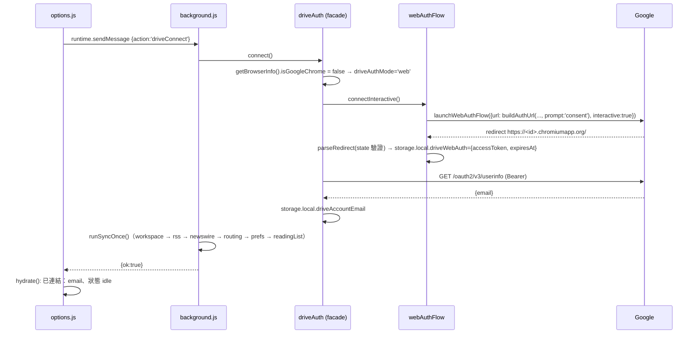
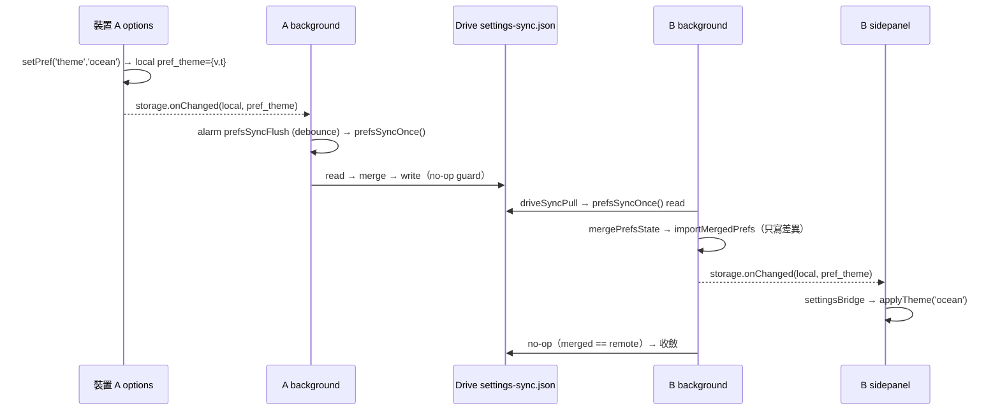
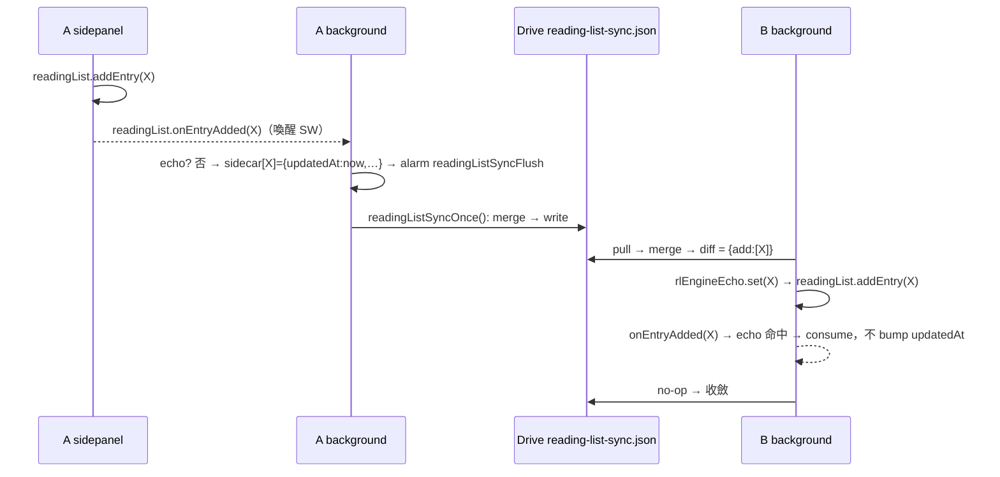

# ISSUE-257 — Dia 瀏覽器相容 + 跨瀏覽器設定同步 SA（系統分析）

| Attribute | Details |
| :--- | :--- |
| **Version** | v1.0 |
| **Status** | Review（待需求方核准後動工） |
| **對應 PRD** | 同目錄 `PRD_spec.md` v1.0（§9 決議已定） |
| **前置研究** | `SPIKE.md`、`dia-api-probe.js` |
| **交付** | 單一 PR，依 WP 分 commit |
| **Issue** | [#257](https://github.com/Tai-ch0802/arc-like-chrome-extension/issues/257) |

---

## 1. 總覽：模組切分

```mermaid
graph TB
    subgraph 新增模組
        CAP[modules/utils/browserCapabilities.js<br/>品牌偵測 + 能力旗標 + 失敗分類]
        WAF[modules/sync/webAuthFlow.js<br/>launchWebAuthFlow implicit flow]
        OCF[modules/sync/oauthConfig.js<br/>WEB_CLIENT_ID]
        PST[modules/prefs/prefsStore.js<br/>per-key 偏好設定 store + 遷移]
        PSL[modules/prefs/prefsSyncLogic.js<br/>純函式 LWW 合併]
        RSL[modules/readingList/readingListSyncLogic.js<br/>純函式 LWW + tombstone 合併]
    end
    subgraph 修改模組
        BG[background.js<br/>入口開關 / 三個 *SyncOnce / alarm / onChanged]
        API[modules/apiManager.js<br/>群組 best-effort 包裝 + readingList 守衛]
        DA[modules/sync/driveAuth.js<br/>auth facade：chrome | web]
        SB[modules/ui/settingsBridge.js<br/>改聽 local pref_*]
        WM[modules/workspace/workspaceManager.js<br/>快照 carry-forward]
        OPT[options.js<br/>備份與同步：email / 範圍 / 能力列]
        UI[aiGrouperUI / tabRenderer / contextMenuManager /<br/>commandPalette.actions / routingRuleUI]
    end
    CAP --> API
    CAP --> BG
    CAP --> UI
    CAP --> WM
    WAF --> DA
    OCF --> WAF
    PSL --> BG
    PST --> SB
    PST --> UI
    RSL --> BG
    DA --> BG
```

---

## 2. Requirement Traceability Matrix

| FR | 模組 | 函式 / 介面 | 測試 |
|---|---|---|---|
| FR-0.01 / 0.03 | `background.js`、`browserCapabilities` | `handleActionClick(tab)`、`sidePanel.onOpened/onClosed` 監聽 | `sidePanelEntry.test.mjs`（純函式 `decideActionClick`） |
| FR-0.02 | `background.js` | `openSidePanelOrFallback(windowId)` | 同上 + 手動（Dia 正式 profile） |
| FR-1.01 / 1.01a / 1.01b | `apiManager`、`browserCapabilities` | `guardTabGroupOp`、`classifyTabGroupFailure`、`resetCapabilityFlagsIfBrowserChanged` | `browserCapabilities.test.mjs`、`apiManagerGroupGuard.test.mjs` |
| FR-1.02 | `aiGrouperUI`、`tabRenderer`、`contextMenuManager`、`commandPalette/actions`、`options.js` | `isTabGroupingAvailable()` + `capabilitiesChanged` 事件 | `aiGrouperUI.test.mjs`（新）、E2E `dia_capability_degrade.test.js`（新） |
| FR-1.03 | `apiManager` | 全部群組 wrapper 經 `guardTabGroupOp` | `apiManagerGroupGuard.test.mjs` |
| FR-1.03a | `workspaceManager` | `carryForwardGroups(snapshot, previous)`（純） | `workspaceGroups.test.mjs`（擴充） |
| FR-1.05 | `browserCapabilities` | 旗標只寫 `storage.local`，不在任何 export 清單 | `prefsSyncLogic.test.mjs`（key 白名單） |
| FR-2.01 / 2.02 / 2.03 | `webAuthFlow`、`driveAuth` | `createWebAuthFlow(deps)`、`buildAuthUrl`、`parseRedirect`、`getToken(interactive)` | `webAuthFlow.test.mjs`、`driveAuth.test.mjs`（新） |
| FR-2.04 | `driveAuth` | `getAuthMode()` / `driveAuthMode` 持久化 | `driveAuth.test.mjs` |
| FR-2.05 | `driveAuth` | `disconnect()` 依模式 | 同上 |
| FR-2.06 / 2.07 | `manifest.json`、`driveAuth.fetchAccountEmail`、`options.js`、`_locales` | — | E2E `happy_path_options_page`（文案）、手動 |
| FR-3.01 ～ 3.06 | `prefsStore`、`prefsSyncLogic`、`settingsBridge`、`background.js`、各讀寫點 | `getPref/setPref/exportPrefsState/importMergedPrefs`、`mergePrefsState`、`prefsSyncOnce` | `prefsStore.test.mjs`、`prefsSyncLogic.test.mjs`、`settingsBridge.test.mjs`（改）、`prefsSyncIntegration.test.mjs`（fake provider） |
| FR-4.01 ～ 4.06 | `readingListSyncLogic`、`background.js`、`apiManager` | `mergeReadingListState`、`diffReadingList`、`readingListSyncOnce` | `readingListSyncLogic.test.mjs`、`readingListSyncIntegration.test.mjs`、E2E `reading_list_edge_cases`（既有） |
| FR-5.01 ～ 5.04 | `options.js`、`_locales`、`web/`、`PRIVACY_POLICY.md`、`GEMINI.md`、wiki | — | `lint-check.sh`、`update-multilingual-docs` |

---

## 3. Module Impact Map

### 3.0 WP0 — 側欄入口（`background.js` + `browserCapabilities`）

```js
// modules/utils/browserCapabilities.js（新）
/** @returns {{isGoogleChrome:boolean, brand:string, majorVersion:number}} */
export function parseBrowserInfo(brands /* navigator.userAgentData.brands|undefined */, uaString);
export function getBrowserInfo();                       // 快取；brands 缺席 → 視為 Chrome（保守）
export function decideActionClick({ isGoogleChrome, panelOpen, sidePanelUnavailable }); // 純：'noop'|'open'|'close'|'popup'
export async function getCapabilityFlag(name);          // 'tabGroupsUnsupported' | 'sidePanelUnavailable'
export async function markCapabilityUnsupported(name);  // 寫 {unsupported:true, brand, majorVersion, at}
export async function resetCapabilityFlagsIfBrowserChanged(); // FR-1.01b，SW onStartup/onInstalled 呼叫
export function classifyTabGroupFailure(errMsg, info, consecutiveFailures); // 純：boolean
export async function isTabGroupingAvailable();         // UI 用；快取 + storage.onChanged 失效
```

`background.js`：

- `onInstalled` / `onStartup`：`resetCapabilityFlagsIfBrowserChanged()` → 若 `!isGoogleChrome` → `sidePanel.setPanelBehavior({openPanelOnActionClick:false})`；Chrome 維持 `true`（現行碼不動）。
- 頂層同步註冊 `chrome.action.onClicked`（MV3 要求）：`handleActionClick(tab)` → `decideActionClick(...)` → `open`：`sidePanel.open({windowId})` 並以 `Promise.race` 等 `onOpened` 3 秒；逾時或 reject → `markCapabilityUnsupported('sidePanelUnavailable')` + `windows.create({type:'popup', url: runtime.getURL('sidepanel.html'), width: 420, height: 800})`；`close`：`sidePanel.close` 存在則呼叫，否則 no-op。
- `sidePanel.onOpened` / `onClosed`（Chromium ≥ 140，Dia 156 的二進位有此符號）→ `storage.session.sidePanelOpenByWindow[windowId]`。事件缺席時 `decideActionClick` 永遠回 `open`（open 對已開面板為 no-op，只是失去 toggle）。
- `_execute_action` 在非 Chrome 由同一個 `onClicked` 進來（Chromium 行為），不另處理。
- **Chrome 零變更**：`isGoogleChrome` 為 true 時 handler 直接 return，避免「關不掉」。

### 3.1 WP1 — 分頁群組降級

`modules/apiManager.js`：

```js
let tabGroupFailStreak = 0;
async function guardTabGroupOp(label, fn) {
    try { const r = await fn(); tabGroupFailStreak = 0; return r; }
    catch (err) {
        tabGroupFailStreak += 1;
        if (classifyTabGroupFailure(err?.message, getBrowserInfo(), tabGroupFailStreak)) await markCapabilityUnsupported('tabGroupsUnsupported');
        console.warn(`[tabGroups] ${label} failed:`, err?.message);
        return null;                                   // 呼叫端以 null 判斷
    }
}
export const groupTabs        = (tabIds, groupId)  => guardTabGroupOp('group',   () => chrome.tabs.group({ tabIds, groupId }));
export const ungroupTabs      = (tabIds)           => guardTabGroupOp('ungroup', () => chrome.tabs.ungroup(tabIds));
export const updateTabGroup   = (id, props)        => guardTabGroupOp('update',  () => chrome.tabGroups.update(id, props));
export const moveTabGroup     = (id, props)        => guardTabGroupOp('move',    () => chrome.tabGroups.move(id, props));
export const addTabToNewGroup = async (tabIds, title, color, windowId) => { /* 已有旗標 → 直接 return null（不嘗試）；否則 guard */ };
export const getTabGroupsInCurrentWindow / getAllTabGroups → catch → []
```

`classifyTabGroupFailure`：`/no window/i.test(msg)` → true；`!info.isGoogleChrome && streak >= 2` → true；其餘（含 `Tabs cannot be edited right now`、`No tab with id`）→ false。

**直接呼叫 `chrome.tabs.group` 的四處改走 wrapper**（來源：call-site 盤點）：`background.js:661`（`create-new-tab-right`）、`modules/commandPalette/actions.js:55`（Spotlight new-tab-right）、`modules/routing/routingEngine.js` L137 / L165 / L187 / L295（SW 可 import `apiManager`；`routingEngine` 另有 `tabGroups.get/update` 於 L102–104 / L169 / L190 → `updateTabGroup` wrapper）。`background.js:805–832` 的 `tabGroups.onCreated` 自動命名只在群組存在時觸發，不動。

**呼叫端對 `null` 的處理**：

| 呼叫端 | 現行 | 變更 |
|---|---|---|
| `readingListManager.addTabToReadingListGroup` L55–64 | 回傳 groupId | 有旗標時 **短路不呼叫**；`openReadingListItem` 不依賴回傳值，`updateReadingListEntry` 必執行（AC-1.01） |
| `aiGrouperUI.handleGroupAction` L140 | 收集 groupId 供 undo | null → 跳過該組並計數；全部 null → toast「此瀏覽器不支援分頁群組」 |
| `workspaceManager.switchWorkspace` L650–656 | 已 try/catch | 改用 wrapper 回傳值，不再重複 try/catch |
| `routingRuleUI.promptCreateRuleForTab` L81–96 | 建群組後存規則 | 有旗標時 contextMenu 不顯示入口（FR-1.02），函式內 null → 不存規則並 toast |
| `routingEngine.applyRule / maybeAiRoute` | 建群組 | null → 規則視為「已套用但無法分群」，不重試、不記 `aiGroups` |
| `dragDropManager` L128/131/187/210 | 操作既有群組 | Dia 上沒有群組 header 可拖，維持 wrapper 即可 |
| `sidepanel.js:122 handleAddToGroupClick` | `addTabToNewGroup` | `.add-to-group-btn` 在旗標下不渲染（`tabRenderer.js:200–207`） |

**UI 隱藏**（FR-1.02，統一以 `isTabGroupingAvailable()` + `document` 事件 `capabilitiesChanged`）：`#ai-group-btn`（`aiGrouperUI.initAiGrouper`，與 `aiGroupingVisible` 並列條件）、`.add-to-group-btn`（`tabRenderer`）、`ctxAlwaysGroupSite`（`contextMenuManager.js:155`）、Spotlight `action-smart-group`（`actions.js:21–26` 的 `isVisible`）、options：`aiGroupingVisible` / `aiAutoNamingEnabled` 兩個 toggle 與 `renderRouting` 區塊加 disabled + 說明列。`settingsBridge` 的 local 分支新增 `tabGroupsUnsupported` → dispatch `capabilitiesChanged`。

`modules/workspace/workspaceManager.js`：

```js
export function carryForwardGroups(snapshot, previous) // 純：依 url 首次比對，補 groupKey/groupTitle/groupColor
export function buildSnapshotFromTabs(tabs, groupsById, { carryFrom } = {}) // groupsById 為 null 或旗標時套 carryFrom
async function snapshotWindowTabs(windowId, { carryFrom } = {})
export async function snapshotIntoWorkspace(id, windowId) // 旗標時傳 carryFrom: workspaces[id].tabSnapshot
```

`createWorkspace`（手動建立，無前快照）不 carry；`workspaceUI.js:306` 預覽呼叫 `buildSnapshotFromTabs(tabs, null)` 不受影響。

### 3.2 WP2 — Web OAuth

```js
// modules/sync/oauthConfig.js（新）
export const WEB_CLIENT_ID = '<GCP Web application client id，使用者提供>';
export const USERINFO_ENDPOINT = 'https://www.googleapis.com/oauth2/v3/userinfo';

// modules/sync/webAuthFlow.js（新，DI，純 JS）
export function buildAuthUrl({ clientId, redirectUri, scopes, state, prompt, loginHint }); // 純
export function parseRedirect(url, { expectedState, redirectOrigin });                     // 純：{accessToken, expiresIn} | throw
export function createWebAuthFlow({ identity, storage, now, randomState, fetchFn, clientId, scopes });
//   .connectInteractive()  → {accessToken, expiresAt, email}；存 storage.local.driveWebAuth
//   .getValidToken({ allowSilent }) → token|null；到期 → interactive:false + prompt=none + login_hint
//   .disconnect()          → revoke + 清 driveWebAuth
//   .getEmail()
```

`modules/sync/driveAuth.js`（facade，對外介面不變：`getToken / isConnected / connect / disconnect / authedFetch`，新增 `getAuthMode / getAccountEmail`）：

- `getAuthMode()`：讀 `storage.local.driveAuthMode`；缺席時：`isGoogleChrome` → `'chrome'`；否則 `'web'`。
- `connect()`：依品牌決定並**持久化**模式 → 對應策略互動式連結 → 成功後 `fetchAccountEmail(token)`（`USERINFO_ENDPOINT`，需 `userinfo.email` scope）→ 存 `driveAccountEmail`（local）。Chrome 模式失敗 **不** 落入 web（FR-2.04）。
- `getToken(interactive)`：`'chrome'` → 現行 `getAuthToken`；`'web'` → `getValidToken({allowSilent: !interactive})`。靜默續期每個 pull 週期最多一次（`driveWebAuth.silentTriedAt`），失敗回 null → 引擎既有邏輯寫 `needs-auth`。
- `authedFetch`：不變（401 → `removeCachedToken` 在 web 模式等於清 accessToken → 重取一次）。
- `disconnect()`：依模式；兩者皆清 `driveAccountEmail`。
- `isConnected()`：`'web'` 模式只看本機 token 是否存在且未過期（**不**在 isConnected 觸發靜默續期，避免每次 alarm 開隱藏視窗）；過期時由 `getToken(false)` 在真正需要時續期。

`background.js`：`driveConnect` / `driveDisconnect` handler 不變（呼叫 facade）。`options.js renderSync`：已連結列顯示 `syncConnectedAs`（email）；失敗文案改 `syncConnectFailedNote`（通用）；能力列（§3.5）。

### 3.3 WP3 — 偏好設定 per-key local + Drive

```js
// modules/prefs/prefsStore.js（新）
export const PREF_DEFS = { theme:{def:'geek'}, listDensity:{def:'cozy'}, customTheme:{def:null},
  backgroundImageConfig:{def:DEFAULT_BG_CONFIG}, sectionOrder:{def:[]}, uiLanguage:{def:'auto'},
  readingListVisible:{def:true}, newswireVisible:{def:true}, aiGroupingVisible:{def:true},
  aiAutoNamingEnabled:{def:true}, aiCleanupVisible:{def:true}, pageReaderVisible:{def:true},
  hoverSummarizeEnabled:{def:true}, readingListSummaryEnabled:{def:true},
  autoArchiveEnabled:{def:false}, autoArchiveIdleHours:{def:12},
  routingEnabled:{def:true}, aiAutoRoutingEnabled:{def:false}, readingListSortOrder:{def:'date-newest'} };
export const PREF_KEY_PREFIX = 'pref_';            // storage.local["pref_"+name] = { v, t }
export async function ensurePrefsMigrated();       // 一次性：flag prefsMigratedFromSync；sync flat key → {v, t:0}
export async function getPref(name);               // 缺 → def
export async function getPrefs(names);
export async function setPref(name, value, { now } = {}); // t = nextTimestamp(prev.t, now)
export async function exportPrefsState();          // {schema:1, entries:{name:{v,t}}}
export async function importMergedPrefs(entries);  // 只寫有差異的 key（no-op guard）
export function isPrefStorageKey(key);             // settingsBridge / background 用

// modules/prefs/prefsSyncLogic.js（新，純）
export const PREFS_SYNC_SCHEMA = 1;
export function mergePrefsState(local, remote);    // per-key：t 大者勝；t 相等取 JSON 字典序大者（交換律）
export function canonicalizePrefs(state); export function prefsStateEqual(a, b);
```

**讀寫點遷移**（來源：sync 區盤點；全部改經 `prefsStore`）：

| 檔案 | 位置 | 變更 |
|---|---|---|
| `modules/ui/settingManager.js` | :51 / :56 / :67 | `getPref('theme')` / `setPref('theme','geek')` / `getPref('listDensity')` |
| `options.js` | :78 / :107 / :121 / :134 / :197 / :215 / :250 / :268 / :333 / :366 / :373 / :380 / :405 / :2268 / :2274 / :2290 / :2525 / :2561 | 全部改 `getPref / setPref`（`FEATURE_TOGGLES` :275 走同一條） |
| `spotlight.js` | :12 | `getPref('theme')` |
| `modules/stateManager.js` | :134–377 各 `init*` / `set*` | `getPref / setPref` |
| `modules/ui/customThemeManager.js` | :32 / :48 | `getPref('customTheme')` / `setPref` |
| `modules/ui/backgroundImageManager.js` | :46 / :62 | `getPref('backgroundImageConfig')` / `setPref`；圖片本體 `custom_bg_image_data` 仍 local、不同步；**`hasImage:true` 而本機無資料時視為無圖**（跨裝置必然發生） |
| `modules/ui/sectionOrderUI.js` | :24 | `getPref('sectionOrder')` |
| `modules/ui/readingListRenderer.js` | :214 / :276 | `readingListSortOrder` |
| `modules/ui/archiveRenderer.js` | :106 / :275 | `getPref('autoArchiveEnabled')`；onChanged 改看 `pref_autoArchiveEnabled` |
| `modules/lifecycle/lifecycleEngine.js` | :37 / :45 / :261–263 | `getPref`；cache 失效改看 `pref_*` |
| `modules/routing/routingEngine.js` | :76 / :84 / :327–328 | 同上 |
| `modules/newswire/feedManager.js` | :209 / :426 | `uiLanguage` |
| `background.js` | :809 | `aiAutoNamingEnabled` |
| `modules/ui/settingsBridge.js` | `resolveSettingChangeActions` | `areaName==='local' && isPrefStorageKey(key)` → 以 `name = key.slice(5)` 走原本 sync 的 mapping；sync 分支只保留 `wsMeta_*`（舊裝置寫入的 sync prefs **忽略**，BASE-014「不 dual-write」） |

**不搬**：`readingListCollapsed`、`archiveCollapsed`、`newswireCollapsed`（D 類）→ 改存 `storage.local` 同名 key（仍不同步；順手離開 sync 以免與 wsMeta 掃描混淆）；`wsMeta_*`、`workspaceMetadata`、`rssSubscriptions`（legacy）不動。`workspaceManager.initWorkspaces` 的 `getStorage('sync', null)` 前綴掃描不受影響。

`background.js` 新增（複製 RSS 模式）：`PREFS_SYNC_FILE='settings-sync.json'`、`ALARM_PREFS_FLUSH='prefsSyncFlush'`、`handlePrefsStorageChange`（local 且 `isPrefStorageKey`）、`prefsSyncOnce()` single-flight：read → `exportPrefsState` → `mergePrefsState` → no-op guard → `importMergedPrefs` / `provider.write`；`runSyncOnce` 尾端 piggyback；onAlarm 明確分支。收斂 ≤ 2 cycle（import 觸發 onChanged → 再跑一次發現無差異）。

**啟動順序**：每個 context 第一次讀 pref 前 `await ensurePrefsMigrated()`（single-flight；`sidepanel.js` / `options.js` / `spotlight.js` / `background.js` 各一處 init）。遷移批次中 `customTheme` 與 `theme` 同批寫入，避免 `theme='custom'` 先到而 `customTheme` 未到的回退（`settingManager.js:56`）。

### 3.4 WP4 — 閱讀清單 Drive 同步（SW 專屬）

```js
// modules/readingList/readingListSyncLogic.js（新，純）
export const RL_SYNC_SCHEMA = 1; export const RL_TOMBSTONE_GC_MS = 180 * 86400e3;
/** state = { schema, entries: {[url]: {title, hasBeenRead, createdAt, updatedAt}}, tombstones: {[url]: deletedAt} } */
export function mergeReadingListState(local, remote, { now, gcMs });  // 交換律 + 冪等；tombstone deletedAt ≥ updatedAt 排除
export function diffReadingList(currentByUrl, merged);                 // {add:[], update:[], remove:[]} 供套用 chrome.readingList
export function readingListStateEqual(a, b); export function canonicalizeReadingListState(s);
```

`background.js`：

- 頂層註冊 `chrome.readingList.onEntryAdded / onEntryRemoved / onEntryUpdated`（存在才註冊；事件會喚醒 SW，所以 sidepanel 端的新增 / 刪除也會被看見）。handler：若 `rlEngineEcho.get(url)` 與事件相符 → consume、只更新 `lastKnown`；否則 `readingListSyncMeta[url] = { updatedAt: nextTimestamp(prev, now), title, hasBeenRead }`，刪除 → `readingListTombstones[url] = now` 並刪 meta。寫入 local 觸發 onChanged → `ALARM_RL_FLUSH='readingListSyncFlush'` debounce。
- `exportLocalReadingListState()`：`readingList.query({})` ∪ sidecar；sidecar 缺席的既有項目以 `updatedAt = 0` 做種（與 RSS seeding 同語意：任何真實編輯或遠端 tombstone 勝出）。
- `readingListSyncOnce()` single-flight：read `reading-list-sync.json` → export → merge → `diffReadingList` → 逐筆 `addEntry / updateEntry({url, hasBeenRead, title})/ removeEntry`，每筆先 `rlEngineEcho.set(url, {...})` 再呼叫 → 更新 sidecar（t 採 merged 的 t，不 bump）→ no-op guard 後 `provider.write`。`runSyncOnce` 尾端 piggyback。
- `readingListManager.deleteEntry` 仍呼叫 `markAsFetched`（RSS 去重）不變。

`modules/apiManager.js`：`hasReadingListApi()`；`queryReadingList` 等在 API 缺席時回 `[]` / no-op；`sidepanel.js` 在缺席時隱藏 `#reading-list-section`（FR-4.05）。

### 3.5 WP5 — options / i18n / 文件

- `options.js renderSync`：新增「同步範圍」清單（6 項）、「已連結：{email}」、「瀏覽器能力」列：`getBrowserInfo()` + 兩個旗標 → `capabilityTabGroupsUnsupported` / `capabilitySidePanelPopupMode`。
- `_locales/*/messages.json` ×14 新增 / 修改 key：`syncConnectFailedNote`（改）、`syncConnectDisclosureMessage`（改：+設定值、閱讀清單 URL/標題、讀取帳號 email）、`syncAccountDesc`（改）、`syncConnectedAs`、`syncScopeHeader`、`syncScopeSettings`、`syncScopeReadingList`、`capabilityRowLabel`、`capabilityTabGroupsUnsupported`、`capabilitySidePanelPopupMode`、`smartGroupUnsupportedToast`、`routingUnsupportedNote`、`nonChromeOnboardingToast`。
- `web/locales` ×14（privacy / guide 對應 key）、`web/privacy.html`、`web/guide.html`、`PRIVACY_POLICY.md`（新增 scope `userinfo.email` 與兩個新 Drive 檔案）。
- `GEMINI.md key_files`：新增 6 個模組條目；`driveAuth.js` 條目改寫（facade）。`docs/wiki/Architecture.md`：Dia 相容段落。release note：§3.3 行為差異、scope 重新同意。

---

## 4. Message Flow

### 4.1 非 Chrome 瀏覽器連結 Drive（WP2）



靜默續期：`getToken(false)` → `expiresAt` 已過 → `launchWebAuthFlow({url: buildAuthUrl(..., prompt:'none', loginHint:email), interactive:false})` → 成功更新 token；失敗（`User interaction required`）→ null → 引擎寫 `needs-auth` → badge。

### 4.2 設定變更跨裝置（WP3）



### 4.3 閱讀清單增刪跨裝置（WP4，含 echo 守衛）



### 4.4 Dia 點圖示（WP0）

`action.onClicked(tab)` → `decideActionClick({isGoogleChrome:false, panelOpen:session[windowId], sidePanelUnavailable})` → `'open'` → `sidePanel.open({windowId})` + 等 `onOpened` 3 秒 → 成功：session 標記；逾時 / reject：`markCapabilityUnsupported('sidePanelUnavailable')` → `windows.create({type:'popup', url:'sidepanel.html'})`；下一次點擊因旗標直接 `'popup'`。

---

## 5. Storage Schema Diff

### 5.1 `chrome.storage.local`（新增 / 變更）

| Key | Shape | 擁有者 | 同步? |
|---|---|---|---|
| `pref_<name>`（19 個，見 `PREF_DEFS`） | `{ v: any, t: number }` | `prefsStore` | ✅ 經 `settings-sync.json` |
| `prefsMigratedFromSync` | `true` | `prefsStore` | ❌ |
| `readingListCollapsed` / `archiveCollapsed` / `newswireCollapsed` | boolean（自 sync 搬來） | 各 renderer | ❌ |
| `driveAuthMode` | `'chrome' \| 'web'` | `driveAuth` | ❌ |
| `driveWebAuth` | `{ accessToken, expiresAt, silentTriedAt? }` | `webAuthFlow` | ❌（**絕不**進 Drive / sync / log） |
| `driveAccountEmail` | string | `driveAuth` | ❌ |
| `tabGroupsUnsupported` / `sidePanelUnavailable` | `{ unsupported: true, brand, majorVersion, at }` | `browserCapabilities` | ❌ |
| `readingListSyncMeta` | `{ [url]: { updatedAt, title, hasBeenRead } }` | SW | ❌（內容進 Drive 檔） |
| `readingListTombstones` | `{ [url]: deletedAt }` | SW | ❌（內容進 Drive 檔） |

### 5.2 `chrome.storage.sync`（變更）

| Key | 變更 |
|---|---|
| 19 個偏好設定 flat key | **停止讀寫**；保留不刪（舊裝置相容；BASE-014 §3.4 同款）；一次性做種到 `pref_*` |
| `readingListCollapsed` / `archiveCollapsed` / `newswireCollapsed` | 停止讀寫 |
| `wsMeta_*`、`workspaceMetadata`（legacy）、`rssSubscriptions`（legacy） | 不變 |

### 5.3 `chrome.storage.session`（新增）

| Key | Shape |
|---|---|
| `sidePanelOpenByWindow` | `{ [windowId]: boolean }` |

### 5.4 Drive `appDataFolder`（新增兩檔）

```jsonc
// settings-sync.json
{ "schema": 1, "entries": { "theme": { "v": "ocean", "t": 1793150600000 }, "sectionOrder": { "v": ["tabs","bookmarks"], "t": 0 } } }

// reading-list-sync.json
{ "schema": 1,
  "entries": { "https://example.com/a": { "title": "A", "hasBeenRead": false, "createdAt": 1793150600000, "updatedAt": 1793150600000 } },
  "tombstones": { "https://example.com/old": 1793000000000 } }
```

既有 `pullRemote` 的 `/^ws_/` 過濾會安全略過這兩個檔案（與 `rss-sync.json` 相同）。

### 5.5 遷移與相容矩陣

| 情境 | 行為 |
|---|---|
| 升級（Chrome，已連 Drive） | `ensurePrefsMigrated` 做種 `t=0` → 第一次 `prefsSyncOnce` 推上 Drive；閱讀清單 sidecar 做種 `t=0` → 推上；`driveAuthMode` 缺席 → `'chrome'`；scope 增加 → 下次互動連結要求重新同意（`getAuthToken` 標準行為，非互動取 token 照常直到使用者重新同意；若 Google 強制 → `needs-auth` badge） |
| 升級（Chrome，未連 Drive） | 做種後本機照常；**失去原生跨裝置設定同步**（release note） |
| 混版（一台舊版仍寫 sync flat key） | 新版忽略 sync prefs；舊版不會看到新版的變更；升級後收斂 |
| 新裝置（Dia，Drive 已有資料） | 本機 defaults `t=0` → pull 後遠端全勝 → 一次到位 |
| 兩裝置離線各改不同 key | per-key LWW → 兩者皆保留 |
| 同 key 同 t（做種後兩邊皆 0 但值不同） | JSON 字典序決定，確定性收斂；之後任一真實編輯勝出 |

---

## 6. Manifest Diff

```diff
   "oauth2": {
     "client_id": "849720332841-ouhe2qbugvd0skkf5sbjlm3ftnn9loop.apps.googleusercontent.com",
-    "scopes": ["https://www.googleapis.com/auth/drive.appdata"]
+    "scopes": [
+      "https://www.googleapis.com/auth/drive.appdata",
+      "https://www.googleapis.com/auth/userinfo.email"
+    ]
   },
```

- 無新增 `permissions`（`identity`、`sidePanel`、`readingList`、`storage`、`alarms` 皆已宣告；`windows.create` 不需權限；`identity.email` 權限**不需要**，因 email 經 userinfo endpoint 取得而非 `getProfileUserInfo`）。
- Web client id 不放 `oauth2`（`getAuthToken` 只認一個 `client_id`），放 `modules/sync/oauthConfig.js`。

---

## 7. 邊界情況與風險

| # | 風險 | 處理 |
|---|---|---|
| R-1 | **R-2.a** appdata 是否跨 client 共享 | 使用者在 WP2 完成後先驗證；不共享 → Chrome 改用 Web client（PRD bump） |
| R-2 | Dia 多 Google 帳號 → `prompt=none` 失敗 | `login_hint=email`；仍失敗 → `needs-auth`，使用者重新連結 |
| R-3 | SW 在 `launchWebAuthFlow` 互動期間被終止 | 互動流程有開啟視窗 → Chromium 延長 SW 壽命；仍失敗則 options 顯示失敗、可重試 |
| R-4 | `rlEngineEcho` 在 SW 重啟後遺失 → 遠端套用被當本機編輯回推一次 | 回推內容與遠端相同 → merge 無差異 → no-op；只多一次寫入，不發散 |
| R-5 | Chrome 原生 reading list 同步 + Drive 同步並存 | 兩者資料相同、LWW + tombstone 收斂；與 RSS 的「可接受殘留」同級 |
| R-6 | `uiLanguage` pull 觸發 sidepanel reload | 只在值真的變更時（import 的 no-op guard 已保證） |
| R-7 | `backgroundImageConfig.hasImage=true` 但另一裝置無圖片資料 | `backgroundImageManager` 視為無圖（實作時加 guard + 單元測試） |
| R-8 | `sectionOrder` 整個陣列 LWW | 可接受；sections 數量固定 |
| R-9 | Chrome 暫時性 `tabs.group` 錯誤誤設旗標 | `classifyTabGroupFailure` 只認 `No window` 或非 Chrome 連續 ≥2 |
| R-10 | `sidePanel.onOpened/onClosed` 在某些版本缺席 | `decideActionClick` 退化為永遠 `open`；Chrome 不受影響 |
| R-11 | WP3 改動面大（≈ 20 個讀寫點）→ 漏改造成某設定不同步或讀到舊值 | `prefsStore` 以外禁止 `getStorage('sync'` 讀 prefs：加 `lint-check.sh` 規則（grep 白名單只允許 `wsMeta_` / legacy） |

---

## 8. Test Impact Analysis

### 8.1 單元測試（`usecase_tests/unit_tests/`）

| 檔案 | 動作 | 內容 |
|---|---|---|
| `browserCapabilities.test.mjs` | 新 | `parseBrowserInfo`（Chrome / Dia brands / undefined）、`classifyTabGroupFailure`（No window / Chrome 暫時錯誤 / 非 Chrome streak）、`decideActionClick`、旗標 reset |
| `apiManagerGroupGuard.test.mjs` | 新 | mock `chrome.tabs.group` 丟 `No window` → 回 null + 旗標；暫時錯誤 → null 無旗標 |
| `workspaceGroups.test.mjs` | 改 | `carryForwardGroups`、`buildSnapshotFromTabs(..., {carryFrom})` |
| `webAuthFlow.test.mjs` | 新 | `buildAuthUrl`、`parseRedirect`（state 不符 / origin 不符 / 缺 token）、`connectInteractive`、靜默續期成功 / 失敗、disconnect |
| `driveAuth.test.mjs` | 新 | 模式判定與持久化、Chrome 不落 web、`getToken` 分派、email 快取 |
| `prefsStore.test.mjs` | 新 | 遷移（flag、`t=0`、customTheme 與 theme 同批）、`setPref` 單調 t、`exportPrefsState` 白名單（旗標 / token 不得出現） |
| `prefsSyncLogic.test.mjs` | 新 | 交換律 / 冪等 / 同 t 決定性 / schema |
| `prefsSyncIntegration.test.mjs` | 新 | fake provider 兩裝置收斂、no-op guard、echo 不發散 |
| `readingListSyncLogic.test.mjs` | 新 | merge / diff / tombstone 排除與復活規則 / GC / 交換律 / 冪等 |
| `readingListSyncIntegration.test.mjs` | 新 | mock `chrome.readingList` + fake provider：add / toggle read / delete 跨裝置、echo 守衛 |
| `settingsBridge.test.mjs` | 改 | sync `theme` → **不再**產生 action；local `pref_theme` → `applyTheme`；local `tabGroupsUnsupported` → `capabilitiesChanged` |
| `workspacePersistence.test.mjs` | 查 | mock 的 sync area 仍只需 `wsMeta_`，預期不變 |
| `lifecycleEngine.test.mjs` | 改 | `autoArchive` 讀取改 mock `pref_*` |
| `authErrorSignal.test.mjs` | 查 | AI provider auth error，與本案無關 |

### 8.2 E2E（`usecase_tests/puppeteer_tests/`）

| 檔案 | 影響 |
|---|---|
| `theme_edge_cases.test.js:45–46` | **改**：`chrome.storage.sync.set({theme:'custom'})` → `storage.local.set({pref_theme:{v:'custom',t:1}})`、`remove('customTheme')` → `remove('pref_customTheme')` |
| `happy_path_theme_switch.test.js` | 預期通過（options select → `setPref` → bridge local 分支） |
| `happy_path_options_page`、`happy_path_routing_options` | 文案 / 新增能力列與同步範圍列不得破壞既有 selector |
| `happy_path_routing_claim_readinglist`、`happy_path_workspace_group_restore`、`add_to_group`、`group_edge_cases`、`happy_path_tab_group_toggle`、`search_group_expand`、`happy_path_lifecycle_archive`、`happy_path_routing_engine` | Chrome 路徑不變，預期通過（wrapper 回傳值語意相同） |
| `reading_list_edge_cases.test.js` | 預期通過；SW 多了事件監聽與 sidecar 寫入 |
| `dia_capability_degrade.test.js` | **新**：預先寫入 `tabGroupsUnsupported` 旗標 → 側欄無 `#ai-group-btn` / `.add-to-group-btn`；點閱讀清單項目 → 分頁開啟且 `hasBeenRead === true`、無 `From Reading List` 群組 |

### 8.3 建置與 harness

- `Makefile`：dev 以 `modules` 整目錄複製、prod 由 esbuild 自入口點 bundle → **新增模組不需改 Makefile**（無新 HTML / CSS / 頂層檔）。
- `GEMINI.md key_files`：新增 `browserCapabilities.js`、`webAuthFlow.js`、`oauthConfig.js`、`prefsStore.js`、`prefsSyncLogic.js`、`readingListSyncLogic.js`；改寫 `driveAuth.js`、`settingsBridge.js`、`apiManager.js` 條目。
- `lint-check.sh`：新增規則「`prefsStore.js` 以外不得出現 `getStorage('sync'` 讀偏好設定」（白名單 `wsMeta_` / legacy / 遷移函式）。
- i18n：14 語 `_locales` + `web/locales` 連動（`update-multilingual-docs`）。

---

## 9. 實作順序（單一 PR，每 WP 一個 commit）

1. **WP1**（最小可用）：`browserCapabilities` + `apiManager` guard + 四處直呼改 wrapper + 呼叫端 null 處理 + UI 隱藏 + 快照 carry-forward + 測試。
2. **WP0**：`action.onClicked` 開關 + popup 退路 + 測試（依 P0 實測結果調整，見 §10）。
3. **WP2**：`oauthConfig` + `webAuthFlow` + `driveAuth` facade + manifest scope + email + options 文案 + 測試。
4. **WP3**：`prefsStore` / `prefsSyncLogic` + 遷移 + 20 處讀寫點 + `settingsBridge` + background 接線 + lint 規則 + 測試（含 E2E 修正）。
5. **WP4**：`readingListSyncLogic` + background 接線 + apiManager 守衛 + 測試。
6. **WP5**：i18n ×14、web、PRIVACY_POLICY、GEMINI key_files、wiki、release note 草稿。
7. 驗證（`verification` skill）：`npm run test:unit`、`npm run test:ci`、`make`；手動：Dia 正式 profile 流程、GCP Web client、R-2.a。

## 10. 待實作前確認（不阻塞 SA 核准）

| # | 項目 | 影響 |
|---|---|---|
| P0 實測 | 使用者在 Dia 正式 profile 做 PRD §10 三步測試 | 面板原生可開 → WP0 只保留退路邏輯（不改預設行為）；不可開 → WP0 如 §3.0 全量 |
| GCP | Web application client id + redirect URI | `oauthConfig.WEB_CLIENT_ID` 填值；實作期間可先用 placeholder，connect 失敗訊息明確 |
| R-2.a | appdata 跨 client 共享 | WP2 完成後第一個手動驗證項 |

---

## Revision History

| Version | Date | Author | Changes |
|---|---|---|---|
| v1.0 | 2026-10-28 | Claude | 依 PRD v1.0 與兩份 call-site / storage 盤點起草 |
